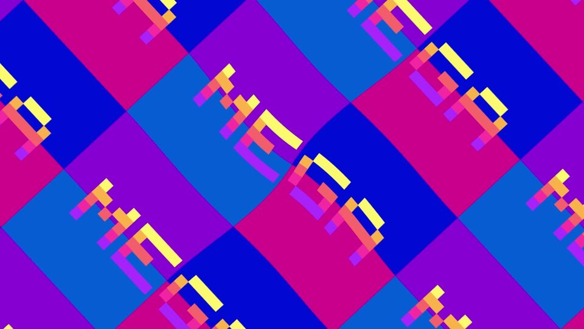

# pyvisualfx

Effects for a [Pyctures](https://github.com/johnwylie70/pyctures) scene. Draw some shapes, then turn one on: a kaleidoscope, a glow, trails that spin away into a tunnel, an old television, a glitch. The page's graphics card does the work, so they are fast, and each is one line.

It is the Python half of [visualfx.js](../visualfx.js). [Every effect](../visualfx.js/docs/effects.md) has a picture of each, the line that turns it on in Python, and its settings.

```python
from pyctures import *
from pyvisualfx import *

glow(1)                 # bright things shine
trails(1.5)             # and leave a trail that takes a second and a half to fade

def draw():
    background("black")
    circle(mouse.x, mouse.y, 40, "gold")
```

Run it with `pyctures run scene.py`. There is nothing to call in `draw()`: an effect that is on is applied to every frame, after your drawing.

## Settings

```python
pattern = kaleidoscope(8, zoom=1.5)

def update(dt):
    pattern.angle += 20 * dt        # turn it, twenty degrees a second
    pattern.x = mouse.x             # its middle follows the mouse
    pattern.y = mouse.y
```

An effect's settings are plain attributes. The first value is the one you most often change; the rest go in by name. Lengths are in the scene's points and angles in degrees. Each effect has `off()`, `on()`, `remove()` and `amount` (0 to 1); `clear_effects()` takes them all away.

Effects are applied in the order you turn them on. `look("arcade")` is several at once: `dream`, `arcade`, `vhs`, `neon`, `comic`, `underwater`, `oldfilm`, `disco`, `terminal`.

A kaleidoscope shows one slice of your picture, the one that starts at the middle and points right. If the screen goes dark, nothing was drawn in that slice: fill the picture, or turn the slice with `angle`.

## The effects

The same as the JavaScript library's, spelled Python's way: `kaleidoscope`, `mirror`, `tile`, `pixelate`, `waves`, `ripple`, `wobble`, `swirl`, `fisheye`, `tunnel`, `blur`, `zoom_blur`, `spin_blur`, `glow`, `trails`, `rgb_split`, `hue`, `saturate`, `brighten`, `contrast`, `invert`, `posterize`, `tint`, `duotone`, `colour_cycle`, `scanlines`, `crt`, `glitch`, `grain`, `vignette`, `edges`, `dots`, `letters`, and the backdrops that need no drawing: `plasma`, `starfield`, `metaballs`, `flow`. There are ninety-four in all, from `droste` and `tilt_shift` to `rain`, `snow`, `fire`, `matrix_rain`, `dither("gameboy")` and `spectrum_bars`: `effect_names()` lists them all, and `look_names()` the looks. `help(trails)` lists a function's settings and where they start; [visualfx.js's README](../visualfx.js/README.md) has a table and a picture of them all.

A backdrop is behind what you draw, so wipe the picture clear instead of painting it: `background()` with no colour.

```python
metaballs("lava")
glow(0.6)

def draw():
    background()
```

A mistake is said on the line that made it:

```
ValueError: mirror's side is one of "left", "right", "top", "bottom", "four", not 'sideways'
```

## Music

With `from synths import *` in the scene:

```python
play_notes("C2 - C2 C2 - C2 G1 -", 0.25, repeat=True)

shine = glow(0.5)
listen_to(sound_output())
react(shine, "strength", "bass", 0.4, 1.5)      # the glow follows the bass
```

`react(effect, "setting", band, low, high)` ties a setting to the music: `"bass"`, `"mids"`, `"highs"`, `"loudness"`, or `"pulse"` (which jumps on each beat and falls away). It is done in the page, on the beat, with no trip through Python.

`bass()`, `mids()`, `highs()`, `loudness()` and `pulse()` are the same numbers for your own drawing. They are what the page last told Python, so they are a frame late: fine for the size of a circle, and `react` is there for anything that must be exact.

## A shader of your own

```python
wave = shader("""
  vec4 effect(vec2 uv) {
    uv.x += 0.02 * sin(uv.y * 40.0 + time * speed);
    return texture(picture, uv);
  }""", speed=3)

wave.speed = 6
```

What the program is given is in [visualfx.js's README](../visualfx.js/README.md#a-shader-of-your-own).

## How it works, and video

Python never touches the page: it may be in a worker, or on another computer. Each function here sends ONE command that turns the effect on in the page, and setting an attribute is one command more. The effects are run once for each frame Python sends, straight after its drawing, and their clock is the `dt` your `update(dt)` is given. So however slow Python is, the picture and its effects stay together, and a scene recorded a frame at a time gives exactly the frames it should.

**With Pyctures.** Pyctures carries this library (on its `effects` branch at the time of writing, as `web/visualfx/`): `from pyvisualfx import *` then needs nothing installed, the page loads its half only for a scene that imports it, and it works the same under `pyctures run`, in a built folder and in a single `.html` file. Such a Pyctures says so with `H_EFFECTS` (handle 13), and gives the frame's seconds as `S.dt`. This module then sends its commands to that handle and reads no file.

**Without it** (an older Pyctures, under `pyctures run` only), the module puts the page's half in the page itself from `src/pyvisualfx/web/visualfx.js`, the JavaScript library copied here by `scripts/sync_js.py`, and reads the frame's seconds where Pyctures hands them to the scene. That script also writes into the module the list of effects and their settings that Python's functions are made from. A page built with `pyctures build` needs the Pyctures that carries the library.

The music's numbers work both ways. A change of scene is seen through the effects only with the Pyctures that carries the library.

## Megademo

[](https://github.com/johnwylie70/megademo)

[Megademo](https://github.com/johnwylie70/megademo) is a demo in the style of the ones made on the C64 and Amiga, made in Circuitry Studio. About forty of these effects, never more than four at once, make up a whole demo cut to a chiptune. It is one file, `main.py`, and it is worth reading for how it is done. [Watch it on YouTube](https://youtu.be/6fKMwrOik5k).

## Working on it

```
python tests/test_runtime.py                                                   # what Python sends, with no browser
PLAYWRIGHT=/path/to/node_modules/playwright node tests/test-browser.mjs        # scenes in a real browser, by `pyctures run`
python scripts/sync_js.py [--check]                                            # the copies of the JavaScript library
```

The browser tests check that the picture a Python scene gives is the one the JavaScript library gives for the same drawing and effects, that the effects run once a frame on Python's clock, and that the Python twin of every demo runs. No sound is made.

MIT licence.
